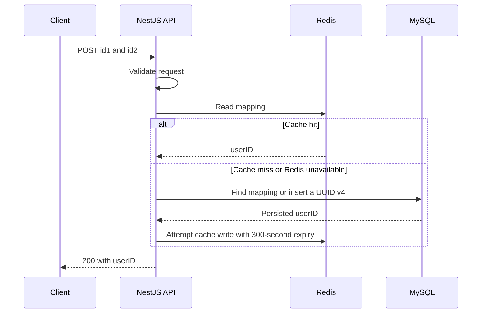

# User ID Resolution API

A NestJS REST API that maps an ordered pair of identifiers (`id1`, `id2`) to a persistent UUID v4 `userID`.

The same identifier pair returns the same user ID. MySQL is the permanent source of data; Redis provides an optional lookup cache.

## Technology Stack

- Node.js 24 LTS and TypeScript
- NestJS
- MySQL 8 with TypeORM
- Redis with the node-redis client
- Jest and Supertest

## Prerequisites

- Node.js 24 LTS and npm
- Docker Desktop, or Docker Engine with Docker Compose
- Available local ports: `3000`, `3306`, and `6379`

Run the following commands from the repository root.

## Installation and Configuration

Install the locked dependencies:

```bash
npm ci
```

For a new checkout, create a local configuration file:

```bash
cp .env.example .env
```

Edit `.env` and replace the placeholder values for:

- `DB_PASSWORD`
- `DB_ROOT_PASSWORD`
- `REDIS_PASSWORD`

Keep `DB_HOST=127.0.0.1` and `REDIS_HOST=127.0.0.1` when running the NestJS application directly on your computer.

The application connects with `DB_USERNAME`, not the MySQL root account. The root password is used by the database container during initialization.

Real credentials belong in `.env`, which is ignored by Git. Only the placeholder configuration in `.env.example` should be committed.

## Database Setup

Start MySQL and Redis:

```bash
docker compose up -d --wait
docker compose ps
```

During initialization of a fresh MySQL data volume, Docker automatically runs:

```text
sql/001-create-user-mappings.sql
```

This creates the `user_mappings` table:

| Column | Definition |
|---|---|
| `userID` | `CHAR(36)`, primary key |
| `id1` | `VARCHAR(255)`, not null |
| `id2` | `VARCHAR(255)`, not null |
| `createdAt` | Timestamp, assigned by MySQL |

A unique constraint on `(id1, id2)` prevents duplicate mappings.

Initialization scripts run only for a fresh database volume. Existing volumes retain their data. TypeORM schema synchronization is disabled.

## Starting the Application

Development mode, with automatic recompilation:

```bash
npm run start:dev
```

Alternatively, build and run the compiled application:

```bash
npm run build
npm run start:prod
```

The default API address is `http://localhost:3000`.

MySQL and Redis run in Docker; the NestJS application runs directly on the host computer.

## API

### POST `/users/resolve`

Both fields are required, must be nonempty strings, and may contain at most 255 characters. Additional request fields are rejected.

```bash
curl -i -X POST http://localhost:3000/users/resolve \
  -H "Content-Type: application/json" \
  -d '{"id1":"ABC123","id2":"XYZ456"}'
```

Successful response — HTTP `200`:

```json
{
  "userID": "550e8400-e29b-41d4-a716-446655440000"
}
```

The UUID above is illustrative. A new pair receives a newly generated UUID v4. Repeating the same pair returns its existing UUID.

| Status | Meaning |
|---|---|
| `200` | Existing or newly created user ID returned |
| `400` | Missing, invalid, or unexpected request fields |
| `500` | Internal processing failure, including a MySQL failure when the cache cannot satisfy the request |

Internal failures return a generic error response without database details:

```json
{
  "statusCode": 500,
  "message": "Internal server error"
}
```

## Redis and Processing Flow

Redis stores mappings under keys formed as:

```text
user-mapping:<JSON representation of [id1, id2]>
```

Each cached mapping expires after 300 seconds.

1. Check Redis for the pair.
2. On a cache miss or Redis failure, query MySQL.
3. If no mapping exists, generate a UUID v4 and insert the record.
4. Attempt to cache the MySQL-confirmed result.
5. Return the user ID.

Redis connection and command errors are handled without preventing MySQL processing. Cache writes are best effort, and the client attempts to reconnect after a connection failure.



## Concurrency Handling

Two concurrent requests may both initially find no existing mapping.

The MySQL unique constraint permits only one insert for a given pair. If another insert fails with `ER_DUP_ENTRY`, the application reads the saved mapping and returns its user ID.

Other database errors are propagated to NestJS error handling.

## Testing

Run the automated tests:

```bash
npm test -- --runInBand
```

The automated tests cover:

- Generating and saving a UUID v4 for a new pair.
- Returning an existing ID without inserting another record.
- Valid HTTP requests.
- Rejecting requests missing `id2`.
- Returning a generic response for internal errors.

Service tests use mocked database and cache dependencies. HTTP tests use an isolated NestJS application with a mocked business service. These tests do not require running MySQL or Redis.

Manual checks also covered real database persistence, concurrent requests, Redis unavailability and recovery, and MySQL unavailability and recovery.

## Assumptions and Design Decisions

- Identifier pairs are ordered: `(A, B)` and `(B, A)` are different pairs.
- Identifiers are case-sensitive and used as supplied; whitespace is not trimmed.
- The 255-character input limit matches the database column definitions.
- MySQL owns the permanent mapping. Expiration or loss of a Redis entry does not remove the MySQL record.
- UUIDs are generated with Node.js `crypto.randomUUID()`.
- The Compose configuration is intended for local assessment and development.

## Stopping Dependency Services

To stop MySQL and Redis while retaining their data:

```bash
docker compose stop
```

To start them again:

```bash
docker compose up -d --wait
```
## Dependency Audit Status

At the time of verification:

- `npm audit --omit=dev` reported zero known vulnerabilities.
- The full audit reported 20 development-dependency findings: 4 low and 16 moderate, with no high or critical findings.
- The unused `@nestjs/mau` deployment dependency was removed.
- Remaining findings affect the development and testing dependency tree and remain unresolved.
- npm's suggested forced remediation includes a breaking downgrade of Jest. No forced downgrades or dependency overrides have been applied.